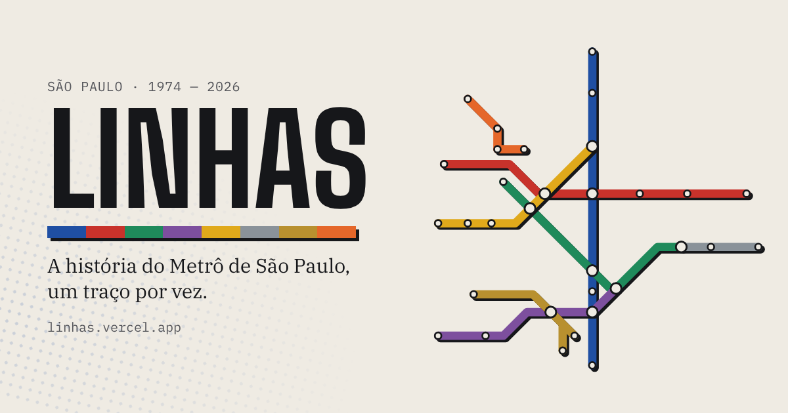

# Linhas



A história do Metrô de São Paulo contada pelo scroll. Em 1974 eram sete estações entre o Jabaquara e a Vila Mariana. Em 2026, a rede ganhou o monotrilho até Congonhas e a Linha Laranja. Cada linha se desenha no mapa no ano em que abriu.

**[linhas.vercel.app](https://linhas.vercel.app)**

Projeto de portfólio de front-end feito por Arthur Monteiro, estudante de Ciência da Computação.

## O que tem na página

- **Mapa que se desenha.** Um mapa esquemático em SVG, com linhas a 45° e 90°, como nos mapas de transporte. Cada capítulo desenha a sua linha, as estações "pulam" no fim do traço e os nomes aparecem por último.
- **Fundo em retícula.** Um shader WebGL escrito à mão, sem biblioteca, que imita o meio-tom de impressão. Os pontos acompanham a cor da linha que está na tela.
- **Viagem guiada.** Um vagão fixo na base da tela leva o visitante de capítulo em capítulo. Ele troca de cor com a linha e vira monotrilho, com viga de concreto no lugar do trilho, nas linhas Prata e Ouro. Foi pensado para quem tem um mouse ruim ou só quer assistir.
- **Curiosidades em trilho horizontal.** Uma seção pinada em que o scroll vertical move os cards para o lado.
- **Hero com fonte variável.** O título anima o eixo de largura da Archivo e entra largo, estreitando até a forma condensada.

## Stack

| | |
|---|---|
| Framework | [Astro](https://astro.build), saída estática |
| Animação | [GSAP](https://gsap.com) + ScrollTrigger |
| Scroll suave | [Lenis](https://lenis.darkroom.engineering) |
| Fundo | WebGL puro (GLSL) |
| Estilo | CSS com custom properties e `@layer`, sem framework |
| Fontes | Archivo, Source Serif 4 e IBM Plex Mono, servidas pelo próprio site via Fontsource |
| Deploy | Vercel |

## Decisões que valem contar

**Sem terminal.** O projeto inteiro foi escrito no github.dev, o editor que roda no navegador. Sem `npm install` local e sem servidor de desenvolvimento. Quem compila é a Vercel, a cada push, e a URL de preview faz o papel do `localhost`. Por isso o toolchain é enxuto e o código é JavaScript, não TypeScript: um erro de tipo só apareceria no build.

**Dados separados da apresentação.** As linhas, o traçado do mapa e as curiosidades ficam em JSON (`src/data`). Cada fato tem a fonte registrada no próprio arquivo. Para adicionar uma linha nova, basta acrescentar o dado e o traçado, sem mexer no componente.

**Movimento com regras.** As curvas de easing ficam nomeadas nos tokens do CSS e em constantes no JavaScript, para o movimento ter a mesma "assinatura" no site inteiro. As animações de scroll mexem em `transform`, `opacity` e `stroke-dashoffset`, que o navegador anima sem recalcular o layout. A exceção consciente é o título do hero, que anima o eixo de largura da fonte uma única vez, na entrada. Com "reduzir movimento" ligado no sistema, o scroll suave e as animações saem e o conteúdo aparece completo.

**Desempenho.** O shader carrega só depois que a página está pronta (`import()` em idle), limita a resolução e pausa quando a aba fica em segundo plano.

### Bugs que viraram regra

- **Safari e `pathLength`.** Desenhar a linha com `pathLength="1"` e `stroke-dasharray` funcionava no Chrome, mas no iPhone as linhas apareciam inteiras desde o início. A solução foi medir cada traço com `getTotalLength()` e animar em pixels.
- **CSS `scale` contra GSAP.** Esconder as estações com a propriedade CSS `scale: 0` e deixar o GSAP fazê-las crescer travava tudo em zero, porque as duas transformações se somam. Agora o estado inicial é definido só pelo GSAP.

## Estrutura

```
src/
  components/   LineMap, TourControl, Curiosidades
  data/         linhas.json, mapa.json, curiosidades.json
  layouts/      Base.astro
  pages/        index.astro, 404.astro
  scripts/      motion, tour, station-hover, backdrop (WebGL)
  styles/       tokens.css, base.css
```

## Rodando localmente

```bash
npm install
npm run dev
```

## Fontes dos dados

Cada fato do site tem fonte. As URLs também ficam no próprio JSON, nos campos `fontes` (linhas) e `fonte` (curiosidades), em `src/data`.

### Linhas

- **Linha 1-Azul** (14/09/1974): [Diário do Transporte: Metrô completa 52 anos (set/2026)](https://diariodotransporte.com.br/2026/09/14/metro-de-sao-paulo-completa-52-anos-com-35-bilhoes-de-passageiros-transportados/), [Gazeta SP: a linha de metrô mais antiga de SP](https://www.gazetasp.com.br/mobilidade/linha-de-metro-mais-antiga-de-sp-tem-mais-de-20km-de-extensao/)
- **Linha 3-Vermelha** (10/03/1979): [nycsubway.org: São Paulo Metro (histórico das linhas)](https://nycsubway.org/wiki/Sao_Paulo_Metro)
- **Linha 2-Verde** (25/01/1991): [nycsubway.org: São Paulo Metro (histórico das linhas)](https://nycsubway.org/wiki/Sao_Paulo_Metro)
- **Linha 5-Lilás** (20/10/2002): [Alstom: lançamento da Linha 5 (out/2002)](https://www.alstom.com/press-releases-news/2002/10/The-launching-of-Line-5-of-Sao-Paulos-metro-20021020)
- **Linha 4-Amarela** (25/05/2010): [Exame: Linha 4 abre com dois anos de atraso (2010)](https://exame.com/economia/atraso-dois-anos-linha-4-metro-abre-sp-562677), [Motiva (ViaQuatro): texto institucional da Linha 4](https://trilhos.motiva.com.br/content/dam/conteudo-multicanal/mobilidade/conteudo/pt/midia/documentos/Texto%20Institucional%20-%20Linha%204%20-%20Amarela.pdf)
- **Linha 15-Prata** (30/08/2014): [Diário do Transporte: dez anos de monotrilho (ago/2024)](https://diariodotransporte.com.br/2024/08/30/dez-anos-de-monotrilho-de-sao-paulo-linha-15-esta-incompleta-e-marcada-por-problemas-e-governo-nao-cogita-mais-este-meio-de-transporte-em-novos-projetos/), [Revista Oeste: 14 de setembro na história do Metrô](https://www.revistaoeste.com/historia/14-de-setembro-na-historia-metro-de-sao-paulo-realiza-primeira-viagem/)
- **Linha 17-Ouro** (31/03/2026): [Diário do Transporte: estação Washington Luís inaugurada (jun/2026)](https://diariodotransporte.com.br/2026/06/30/linha-17-ouro-tem-horario-de-operacao-ampliado-em-duas-horas-estacao-washington-luis-e-inaugurada-nesta-terca-30-com-12-anos-de-atraso/), [Diário do Transporte: inauguração da Linha 17-Ouro (mar/2026)](https://diariodotransporte.com.br/2026/03/31/governador-tarcisio-de-freitas-inaugura-linha-17-ouro-de-monotrilho-e-afirma-que-estudo-da-linha-20-rosa-ficara-pronto-ao-final-de-2026/)
- **Linha 6-Laranja** (02/07/2026): [Band: Linha 6-Laranja inaugurada (jul/2026)](https://www.band.com.br/noticias/linha-6-laranja-e-inaugurada-com-estacao-mais-profunda-da-america-latina-202607021046)

### Curiosidades

- **Jabaquara**: [Diário do Transporte: dez fatos da história dos transportes](https://diariodotransporte.com.br/2020/01/25/parabens-sao-paulo-dez-fatos-da-historia-dos-transportes-na-cidade/)
- **Vila Mariana**: [Gazeta SP: a linha de metrô mais antiga de SP](https://www.gazetasp.com.br/mobilidade/linha-de-metro-mais-antiga-de-sp-tem-mais-de-20km-de-extensao/)
- **Santa Cruz**: [Diário do Transporte: obras da Linha 6 (jan/2026)](https://diariodotransporte.com.br/2026/01/06/obras-da-linha-6-laranja-atingem-77-de-conclusao-e-inicio-da-operacao-e-previsto-para-outubro/)
- **Água Branca**: [Band: Linha 6-Laranja inaugurada (jul/2026)](https://www.band.com.br/noticias/linha-6-laranja-e-inaugurada-com-estacao-mais-profunda-da-america-latina-202607021046)
- **Itaberaba-Hospital Vila Penteado**: [Diário do Transporte: entregas adiadas na Linha 6 (nov/2026)](https://diariodotransporte.com.br/2026/11/02/estacoes-brasilandia-e-itaberaba-hospital-vila-penteado-da-linha-6-laranja-tem-entregas-adiadas-para-fim-de-2026/)
- **Aeroporto de Congonhas**: [Diário do Transporte: estação Washington Luís inaugurada (jun/2026)](https://diariodotransporte.com.br/2026/06/30/linha-17-ouro-tem-horario-de-operacao-ampliado-em-duas-horas-estacao-washington-luis-e-inaugurada-nesta-terca-30-com-12-anos-de-atraso/)

As datas das linhas 2 e 3 vêm de uma fonte secundária especializada em história do transporte (nycsubway.org); a confirmação em documento do próprio Metrô ainda está por fazer.

O mapa é esquemático e foi desenhado do zero, com base na topologia da rede. O projeto não tem vínculo com a Companhia do Metropolitano de São Paulo e não usa a identidade visual dela.